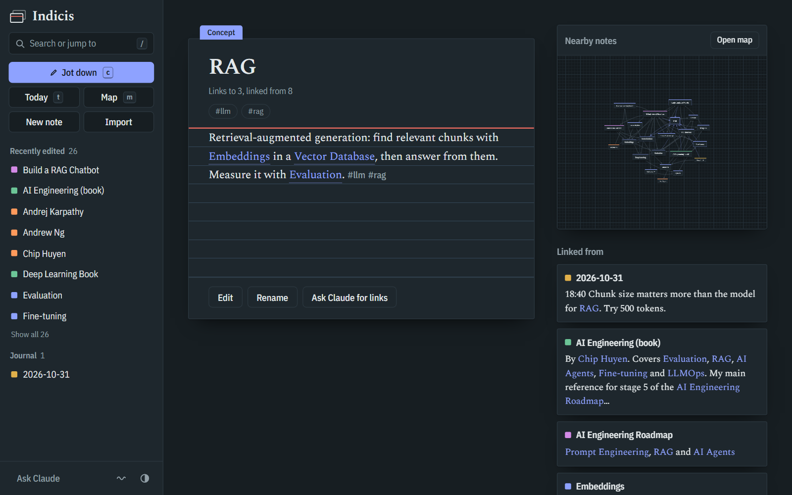
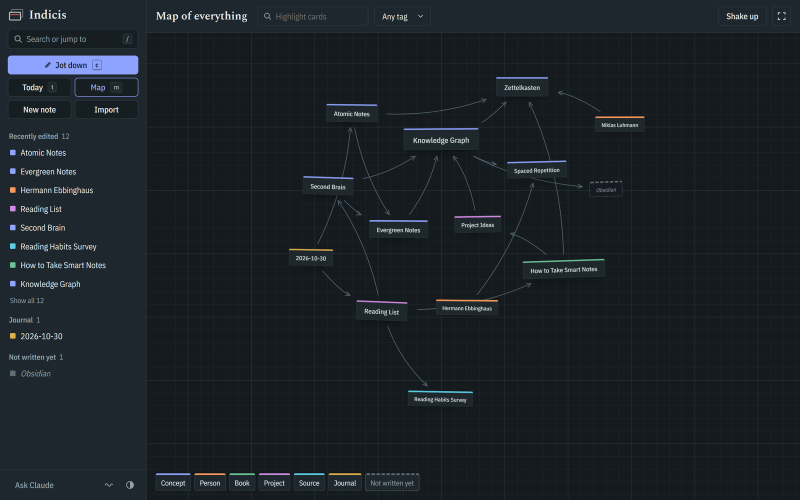
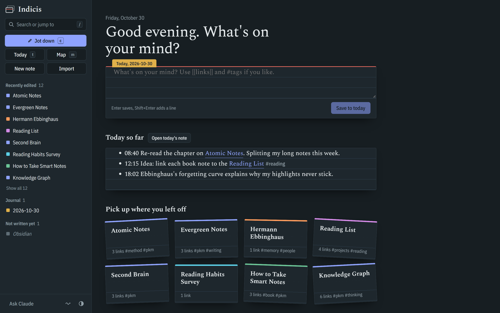
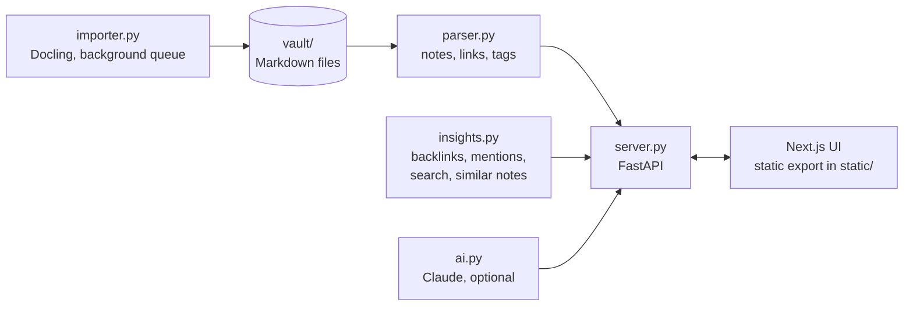

<div align="center">

<picture>
  <source media="(prefers-color-scheme: dark)" srcset="docs/logo-dark.svg">
  
</picture>

# Indicis

**Your notes as a slip box of linked index cards, on your own computer.**

Write in plain Markdown, link ideas with `[[wiki-links]]`, and watch them form a living graph.
Import PDFs and papers as notes. Let Claude suggest connections you missed, only when you ask.


[](LICENSE)

<br>



</div>

<br>

*Indicis* is Latin for "of the index". It's named after the card index, the *Zettelkasten*, that the sociologist Niklas Luhmann used to write some 70 books.

## Contents

- [Why Indicis](#why-indicis)
- [Features](#features)
- [Quick start](#quick-start)
- [Writing notes](#writing-notes)
- [Importing documents](#importing-documents)
- [Claude suggestions](#claude-suggestions-optional)
- [Keyboard shortcuts](#keyboard-shortcuts)
- [How it works](#how-it-works)
- [Development](#development)
- [Configuration](#configuration)
- [Privacy](#privacy)
- [Acknowledgements](#acknowledgements)
- [License](#license)

## Why Indicis

Most note apps either bury ideas in folders or show a graph that's pretty and useless. Indicis puts the note you're working on in the middle and its neighbourhood beside it: what links here, what mentions it without a link, and what's similar. The full graph is still there when you want the big picture.

- **Plain files.** Every note is a Markdown file in `vault/`. Open the same folder in Obsidian, edit it in any editor, or keep it in git.
- **Capture first.** Press `c` anywhere to jot a thought into today's journal. Organise later.
- **Connections, not folders.** Backlinks show the sentence around each link. Unlinked mentions turn into links with one click.
- **Local by default.** Search, similar notes and document import all run on your machine. Nothing leaves it unless you ask Claude.

## Features

<table>
<tr>
<td width="50%" valign="top">

### Write and capture
- A **desk** with an inline capture box, today's journal and your recent cards
- **Quick capture** from anywhere into `journal/YYYY-MM-DD.md`
- An editor that suggests note titles as you type `[[`
- **Rename** that rewrites every link to the note
- Obsidian-style front matter: `type`, `tags`, `aliases`

</td>
<td width="50%" valign="top">

### Find and connect
- **Full-text search** and commands in one palette (`/` or `Ctrl+K`)
- **Backlinks with context**: the sentence each link sits in
- **Unlinked mentions**, linked with one click
- **Similar notes**, found locally with TF-IDF
- Lists of notes **not written yet** and notes **linked to nothing**

</td>
</tr>
<tr>
<td width="50%" valign="top">

### See the shape of your ideas
- A **live physics graph**: cards hang on springy links, swing when you drag them, and settle
- A **local graph** beside every note that follows what you open
- A full-screen **map** with filters and quick previews
- A switch to keep the graph still, and support for reduced motion

</td>
<td width="50%" valign="top">

### Bring in what you read
- **Import** PDFs, Word, PowerPoint, Excel, HTML, EPUB and scans
- Converted on your machine by **Docling**: layout, tables, figures and text recognition
- Long documents split into a contents note plus linked section notes
- Optional **Claude** link and tag suggestions, which you approve one by one

</td>
</tr>
</table>

<p align="center">
  
  
</p>

## Quick start

You need **Python 3.10 or newer**.

```bash
git clone https://github.com/Jishnuraj07/indicis.git
cd indicis
pip install -r requirements.txt
python -m uvicorn server:app --port 8000
```

Open **http://localhost:8000**. The `vault/` folder comes with a few sample notes; delete them or replace the folder with your own Markdown notes (see [Configuration](#configuration)).

The built interface is committed in `static/`, so Node.js is only needed if you want to change the UI.

## Writing notes

A note is a Markdown file. The file name is its title, unless front matter sets one.

```markdown
---
type: concept          # concept, person, book, project, source, journal or note
aliases: [Slip box]    # other names that count as mentions
---
# Zettelkasten

A note-taking method by [[Niklas Luhmann]]: small notes, each with one idea,
linked densely to each other. See also [[Atomic Notes|atomic notes]].

#pkm #method
```

- `[[Title]]` links to a note, and `[[Title|shown text]]` changes the link text.
- A link to a note that doesn't exist yet appears as a dashed card, ready to be written.
- `#tags` anywhere in the text are picked up for filtering.

## Importing documents

Drop a file anywhere on the app, or use **Import**. Each document gets its own folder:

```
vault/sources/Reading Habits Survey/
├── Reading Habits Survey.md      # the note (type: source)
├── reading-survey.docx           # the original
└── images/                       # figures extracted from it
```

Documents over about 3,000 words become a contents note plus one note per section. Imported notes work like any other: they show up in search, backlinks, mentions, similar notes and the map.

Import uses [Docling](https://github.com/docling-project/docling), which is optional because it's a large download (it includes PyTorch):

```bash
pip install docling
```

Restart the server afterwards. The first import downloads Docling's layout and text-recognition models.

## Claude suggestions (optional)

**Ask Claude for links** reads one note and proposes links to existing notes, new notes worth writing and tags, each with a reason. Nothing is written until you tick what you want. **Ask Claude** in the rail does the same for every note.

It uses the Anthropic API. Set `ANTHROPIC_API_KEY`, or sign in with `ant auth login`, then restart the server.

## Keyboard shortcuts

| Key | Action |
| --- | --- |
| `/` or `Ctrl+K` | Search everything, or run a command |
| `c` | Jot something into today's note |
| `t` | Open today's note |
| `m` | Open the map (press again to go back) |
| `[[` | In the editor: pick a note to link |
| `Ctrl+S` | In the editor: save |
| `Esc` | Close a dialog or leave the editor |

## How it works



- **Server:** a single FastAPI process serves both the API and the UI. The UI is a Next.js app exported as static files, so there's one command to run.
- **Live updates:** the server fingerprints the vault, and the UI refreshes when files change, including edits made in Obsidian or a text editor.
- **Graph:** a [d3-force](https://github.com/d3/d3-force) simulation, drawn as real DOM cards with SVG links. The swinging and wobbling come from springs on each card's tilt and on each link's curve.

```
indicis/
├── server.py          API and static file server
├── parser.py          reads the vault, builds the graph
├── insights.py        backlinks, mentions, search, similar notes, rename, journal
├── importer.py        document import with Docling
├── ai.py              Claude link and tag suggestions
├── vault/             your notes
├── static/            the built UI (generated)
└── web/               the UI source (Next.js)
    ├── app/           pages: desk and notes (/), map (/map)
    ├── components/    Graph, Shell (rail, capture), Palette, Panel, Workspace, MapView
    └── lib/           shared state and API helpers
```

## Development

The UI needs **Node.js 20.9 or newer**.

```bash
# terminal 1: the API
python -m uvicorn server:app --port 8000 --reload

# terminal 2: the UI with live reload on http://localhost:3000
cd web
npm install
npm run dev
```

`npm run build` exports the finished UI into `static/`, which is what the server serves.

## Configuration

| Variable | Default | Purpose |
| --- | --- | --- |
| `KG_VAULT` | `./vault` | Folder of notes to use, for example an existing Obsidian vault |
| `KG_MODEL` | `claude-opus-5-5` | Claude model for suggestions |
| `ANTHROPIC_API_KEY` | none | Enables Claude suggestions |

## Privacy

Your notes stay in a folder on your computer. Search, similar notes, document conversion and the fonts all work offline. The only thing that sends data anywhere is **Ask Claude**: it sends the text of the note you're asking about, plus your note titles, to the Anthropic API, and only when you click it.

## Acknowledgements

- [Docling](https://github.com/docling-project/docling) for document conversion
- [d3-force](https://github.com/d3/d3-force), [Next.js](https://nextjs.org), [FastAPI](https://fastapi.tiangolo.com) and [marked](https://marked.js.org)
- [Spectral](https://fonts.google.com/specimen/Spectral) and [IBM Plex Sans Condensed](https://fonts.google.com/specimen/IBM+Plex+Sans+Condensed) typefaces
- Niklas Luhmann's Zettelkasten and Andy Matuschak's writing on evergreen notes, for the ideas

## License

Indicis is released under the [MIT License](LICENSE).
